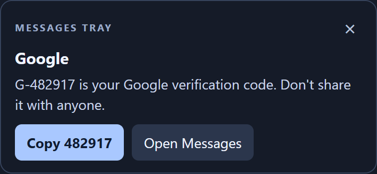
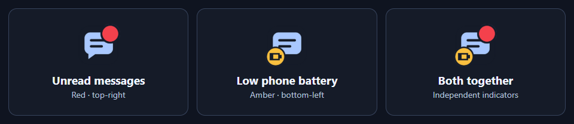

<p></p>

# Google Messages Tray for Windows

**Your texts in the tray. Your verification codes, one click away.**

[](https://github.com/TylerBuza/google-messages-tray/releases/latest)
[](LICENSE)
[](https://github.com/TylerBuza/google-messages-tray/actions/workflows/ci.yml)
[](#known-limitations)

**Messages Tray** is an unofficial, open-source **Google Messages desktop companion for Windows**. Keep your Android phone's texts available in the system tray—without a tab in your normal Chrome window—and copy detected SMS verification codes directly from desktop notification popups.

<p align="center">
  
  <br /><sub>Google sign-in on your PC → receive the text → copy the code. Sample message; code is fictional.</sub>
</p>

## Why use it?

- **No regular Chrome tab.** Messages runs in a separate Chrome app window that hides completely to the tray.
- **Copy verification codes.** Detected numeric OTP / 2FA codes get a one-click **Copy** button.
- **Click X, keep receiving.** The app's close button hides the window instead of shutting down Messages.
- **Unread tray badge.** A small red dot marks observed unread conversations, even with popups paused. Reading them clears it; simply opening the window does not.
- **Phone low-battery indicator.** An amber battery marker appears at bottom-left, opposite the red unread dot, while Google's phone-battery warning is visible. Both indicators can appear together; pausing popups does not pause status indicators.
- **Links use your normal browser.** Web links from messages open through Windows' default browser, outside the dedicated Messages profile. Google's Messages and sign-in pages stay in the app.
- **Open only when you need it.** Double-click the tray icon to bring Messages to the foreground and read or reply in Google's familiar web interface. Explicitly opening Messages dismisses pending popup previews, without marking conversations read automatically.
- **Portable Windows app.** No browser extension, administrator access, or installer required. Starting with Windows is optional.
- **Local companion, open source.** No app analytics, message-forwarding service, or subscription. Google Messages itself still connects to Google.

### Tray indicators at a glance



The amber marker follows Google's phone low-battery warning; the red dot remains independent. No battery percentage is guessed.

Built for Android users who work on Windows and are tired of reaching for their phone—or hunting for a browser tab—every time a website sends a sign-in code.

## Download and get started

**[Download the latest Windows x64 EXE →](https://github.com/TylerBuza/google-messages-tray/releases/latest)**

Requires **Windows 10/11 x64**, installed **Google Chrome**, and an Android phone using Google Messages. This is a **public beta**, not an official Google product.

1. Download `Messages-Tray-<version>.exe` from **Releases** and keep it in a stable folder.
2. Run it. A separate Chrome app window opens for Google Messages.
3. Sign into Google and complete phone pairing. Your normal Chrome profile is not reused.
4. **Click X** or **Hide to tray**. The window and taskbar entry disappear; Messages keeps running.
5. Request a verification text. If its preview contains a recognized code, click **Copy [code]** in the popup.

**Double-click the tray icon** to open Messages again. Right-click it for a demo notification, pause, optional startup, or **Quit Messages Tray**. Windows may put the icon in the **^** overflow area.

> **Unsigned download:** Windows may show a SmartScreen warning. Releases are not code-signed. Check the published SHA-256 checksum, inspect the source, or build it yourself; do not run a binary you do not trust. A checksum verifies file integrity, not publisher identity or safety.

### VirusTotal reports

Release notes include a SHA-256 VirusTotal lookup link. **A lookup link does not mean a scan was submitted or completed.** When the configured release workflow uploads an EXE, the notes also record its submission time and analysis link. Check the live report for actual engine results; submission success is not a clean verdict. VirusTotal results do not guarantee safety, and unsigned apps/native hooks can trigger heuristic detections.

Only already-public release EXEs are submitted, never messages or Chrome profiles. Submissions may be shared with security vendors. Maintainers: see [VirusTotal setup and older-release submissions](docs/VIRUSTOTAL.md).

<details>
<summary>Upgrading from an earlier version</summary>

Quit the old version using its tray menu before launching the new EXE. Pairing stays in the same dedicated Chrome profile. If you enabled **Start with Windows**, disable it in the old version first, then enable it in the new version from its final file location. Existing browser data is not deleted during upgrades.

</details>

## What runs on your PC?

Messages Tray is a small-purpose Electron controller plus a **real, installed Chrome instance**, using a dedicated profile. Electron is used for the tray and notification UI—not for Google sign-in. Google still controls account access.

- Google's page notifications feed the companion's popups, with an unread-conversation-list fallback.
- A local Windows helper turns a mouse click on this app's X button into **hide to tray**. Other Chrome windows are not changed.
- Verification-code recognition runs locally. Copying is explicit; messages are not forwarded to an app server.
- The dedicated browser profile is sensitive. Chrome is controlled through a **loopback-only debugging port**, accessible to other software on your PC. See [Privacy & security](PRIVACY.md) before using it on a shared or untrusted computer.

There is no subscription, extension, or app backend. There **is** an Electron + Chrome memory footprint; this is not advertised as a lightweight replacement for a browser.

## Known limitations

- **Best-effort notification detection.** Google has no public Messages notification API for this use. Site changes, service-worker notifications, pairing issues, network interruptions, and sleep can interrupt or duplicate delivery. Do not rely on it as your only way to receive an important code.
- **Custom desktop popups, not Windows Notification Center toasts.** They fit their content, last about 18 seconds, stack up to three, and pause while hovered. Rapid messages from the same chat share a popup showing the latest text; bursts reuse the existing windows instead of opening an unlimited backlog. Hovered messages are not replaced until you move away. They do not enter notification history. Windows Do Not Disturb does not control them; use **Pause notifications** in the tray.
- **Numeric codes only:** 4–8 digits, including `123 456` and `123-456`. Detection is heuristic; check the code before using it. Alphanumeric codes or codes missing from Google's preview need manual copying.
- **Mouse X hides; Alt+F4 does not.** Keyboard Alt+F4 and Chrome's system-menu Close are not intercepted. Minimizing alone may leave a taskbar icon.
- Clicking a popup opens the existing Messages window, not necessarily the sender's thread. No conversations are automatically opened to fetch codes.
- An active, visible conversation can suppress Google's notifications. Hide the window for background use, and keep notifications enabled in Google's Messages settings.
- Locking Windows suppresses companion popups and clears the in-memory last-code shortcut. Suppressed texts are not replayed after unlock. Other site permissions are denied for the Messages origin.
- Subsequent launches start minimized, then hide; a brief taskbar flash is possible. The tray indicates that the app is running, not that your phone is connected.
- The unread badge is recalculated from Google's currently loaded conversation list, not a guaranteed account-wide count. Removed rows do not retain old unread flags. Older or unloaded conversations may not be represented until Google loads them. No texts are marked read automatically.
- The battery marker follows Google's English phone low-battery banner, not direct Android telemetry or the PC battery. It clears when the banner is hidden/dismissed or the Messages page becomes unavailable; dismissing the banner does not mean the phone is charged. No battery percentage is guessed. Google layout or language changes can affect detection.
- The release is unsigned and currently Windows x64 only. Google sign-in/phone pairing and real incoming SMS require a live user test; automated tests use synthetic messages.

Need help? See [troubleshooting](docs/TROUBLESHOOTING.md) or [report a bug](https://github.com/TylerBuza/google-messages-tray/issues/new/choose). **Never attach real verification codes, texts, pairing QR codes, cookies, or browser profiles.**

## Build from source

Requires Node.js 24+, npm, Windows, and installed Google Chrome.

```powershell
git clone https://github.com/TylerBuza/google-messages-tray.git
cd google-messages-tray
npm ci
npm test
npm start
```

```powershell
npm run build                  # portable EXE in release/
npm start -- --smoke-test      # synthetic Chrome → popup → X-to-tray integration test
npm run demo                   # regenerate the fictional-message screenshot
```

The smoke test uses a disposable Chrome profile and locally fulfilled page content. It tests code copying UI and the native X callback without moving the physical pointer, signing in, reading real texts, or modifying the clipboard. Chrome can still make its own background network requests. See [CONTRIBUTING.md](CONTRIBUTING.md) for architecture and test details.

## Contributing and security

Bug reports, reproducible Google DOM changes, notification compatibility improvements, and accessibility work are welcome. Read [Contributing](CONTRIBUTING.md), [Security policy](SECURITY.md), and [Privacy](PRIVACY.md).

**License:** [MIT](LICENSE). Google Messages and Google Chrome are trademarks of Google LLC. This independent project is not affiliated with, endorsed by, or supported by Google.
